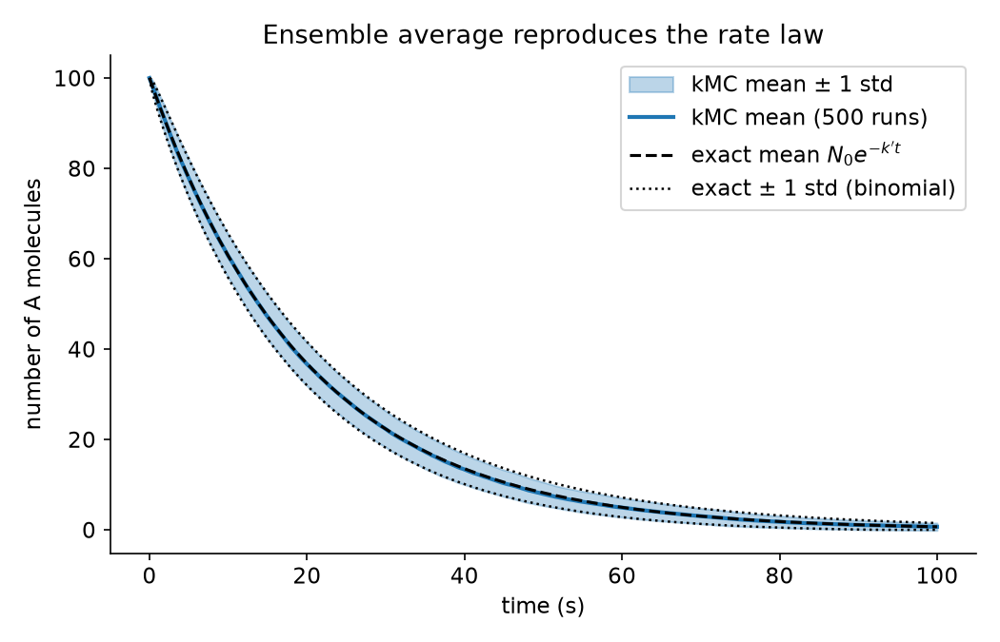

# Gillespie kMC of a Pseudo-First-Order Decay

A small, tested Python implementation of the **Gillespie direct method** (a kinetic Monte Carlo algorithm) applied to the pseudo-first-order decay

```
A + B  --k-->  C + B        ([B] >> [A], so [B] stays ~constant)
```

and validated against the exact analytical solution.

## Background

With B in large excess the rate law reduces to first order in A:

```
d[A]/dt = -k[A][B] ≈ -k'[A],     k' = k[B]      =>     [A](t) = [A]₀ exp(-k' t)
```

That deterministic law is only the *average* behaviour. With a finite number of molecules, decay is a random process. The Gillespie method simulates it exactly:

1. Compute the total event rate (propensity) `a = k' N`.
2. Draw the waiting time to the next event: `τ = -ln(u) / a`, with `u ~ Uniform(0, 1]`.
3. Apply the event: `N → N - 1`, advance time by `τ`.
4. Repeat until `N = 0`.

Because there is only one reaction channel, there is no need to pick *which* reaction fires. A multi-reaction version would add that step.

## Results

Parameters: `k = 0.1 M⁻¹s⁻¹`, `[B] = 0.5 M` → `k' = 0.05 s⁻¹`, `N₀ = 100`, 500 runs.

| Individual trajectories | Ensemble mean ± std vs exact |
|---|---|
|  |  |

Fitting `ln(⟨N⟩/N₀)` against time recovers `k' = 0.0503 s⁻¹` (true value 0.05, 0.5 % error):


Why the exact reference is binomial: each molecule survives to time `t` independently with probability `p = e^(-k't)`, so `N(t) ~ Binomial(N₀, p)` with mean `N₀p` and variance `N₀p(1-p)`. The kMC mean *and* spread both match this. Relative noise at the half-life scales as `1/√N₀` (see the notebook), so the deterministic law is the large-`N` limit.

## Project layout

```
gillespie_decay/core.py     simulation + analytical reference functions
tests/test_core.py          pytest suite (12 tests)
make_figures.py             regenerates figures/
gillespie_decay.ipynb       step-by-step walkthrough
```

## Run it

```bash
python -m venv .venv && source .venv/bin/activate
pip install -r requirements.txt
python -m pytest          # run the tests
python make_figures.py    # regenerate figures
jupyter notebook gillespie_decay.ipynb
```

## How it is tested

The tests check statistical properties, using fixed seeds and a 4-standard-error tolerance:

- trajectory structure (time strictly increasing, exactly one molecule lost per event, ends at 0)
- the first waiting time is exponential with mean `1/(k'N₀)`
- the ensemble mean follows `N₀ exp(-k't)` at every grid point
- the ensemble variance matches the binomial `N₀p(1-p)`
- the mean equals `N₀/2` at `t = ln2 / k'`
- input validation and seed reproducibility

## Limitations / possible extensions

- Treats `k'` as a per-molecule rate and ignores volume scaling and the units of the stochastic rate constant.
- Only one reaction channel. Natural next steps: a general multi-reaction Gillespie engine, reversible reactions (A ⇌ C), or depleting B to show where the pseudo-first-order approximation breaks down.
