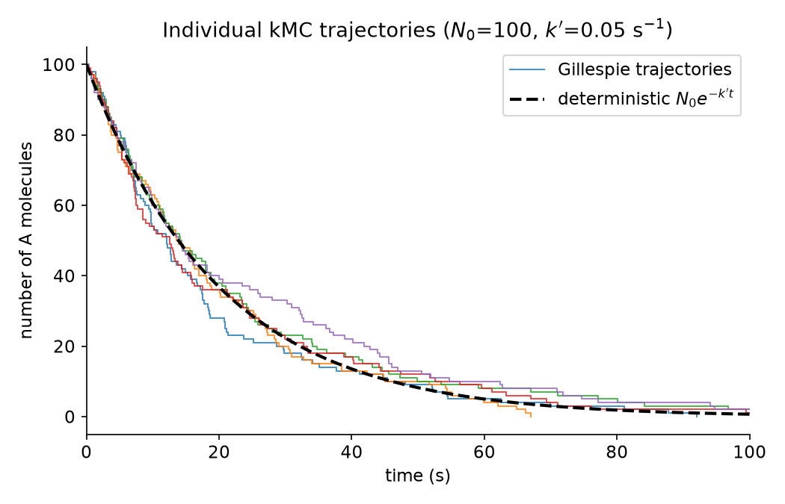
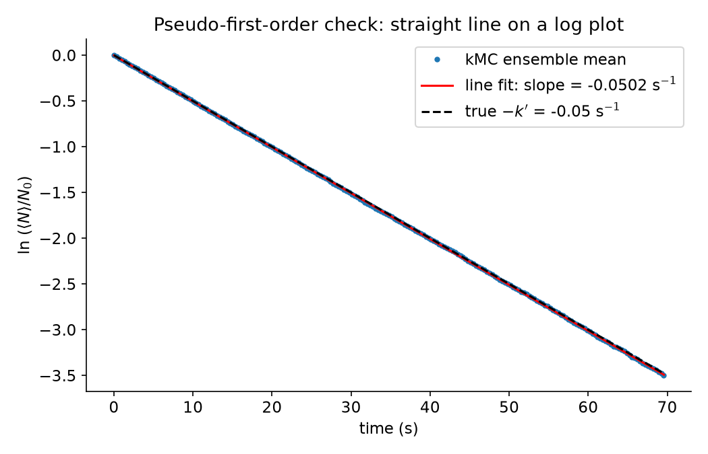

# Gillespie kMC of a Pseudo-First-Order Decay

A small, tested Python implementation of the **Gillespie direct method** (a kinetic Monte Carlo algorithm), applied to the pseudo-first-order decay

```
A + B  --k-->  C          (B in large excess, so [B] barely changes)
```

and validated against the exact analytical solution.

## Background

With B in large excess the rate law reduces to first order in A:

```
d[A]/dt = -k[A][B] ≈ -k'[A],     k' = k[B]₀      =>     [A](t) = [A]₀ exp(-k' t)
```

That deterministic law is only the *average* behaviour. With a finite number of molecules, decay is a random process. The general Gillespie direct method (`gillespie_direct`) takes a list of reaction channels with propensities `aⱼ` and repeats:

1. `a₀ = Σⱼ aⱼ`, the total event rate.
2. Waiting time to the next event: `τ = -ln(u₁) / a₀`.
3. **Event selection:** reaction `j` fires with probability `aⱼ / a₀` (found with a second random number `u₂`).
4. Apply it (`x → x + stoichⱼ`) and advance time by `τ`.

The decay itself has one channel (`a = k'N`), so selection is trivial there. It is tested non-trivially on a two-channel reversible reaction (see below).

## Results

Parameters: `k = 0.1 M⁻¹s⁻¹`, `[B] = 0.5 M` → `k' = 0.05 s⁻¹`, `N₀ = 100`, 500 runs.

| Individual trajectories | Ensemble mean vs exact, with pass/fail panel |
|---|---|
|  |  |

**Headline number.** Pooling the 50 000 molecular lifetimes from the 500 runs (the event times of a completed decay are order statistics of independent Exp(k') lifetimes), the unbiased maximum-likelihood estimate is

```
k' = 0.05025 ± 0.00022 s⁻¹ (s.e.),   95 % CI [0.04981, 0.05070],   true value 0.05  (z = +1.13)
```

The true value lies inside the CI. A bare "0.5 % error" would be uninformative, because the standard error at this sample size is already about 0.45 %.

**Fig 2 is a test, not a picture.** The lower panel shows the z-score of the simulated mean against the exact mean `N₀e^(-k't)` at each of 300 times, in units of the standard error (the exact binomial std divided by √runs). `make_figures.py` exits with an error if `max|z| ≥ 4`; here `max|z| = 2.14`. The same check, applied to data simulated with a rate 10 % too high, fails (`max|z| ≈ 18`). That is verified in the test suite.

The exact reference is binomial: each molecule survives to time `t` independently with probability `p = e^(-k't)`, so `N(t) ~ Binomial(N₀, p)`, with mean `N₀p` and variance `N₀p(1-p)`.

Fig 3 (log plot of ⟨N⟩, straight line with slope `-k'`) is an illustration only; the quantitative claim is the estimate above.



## Project layout

```
gillespie_decay/core.py     general Gillespie engine, decay wrappers, analytical reference, estimator
tests/test_core.py          pytest suite (23 tests)
make_figures.py             regenerates figures/ and runs the pass/fail checks
gillespie_decay.ipynb       step-by-step walkthrough
```

## Run it

```bash
python -m venv .venv && source .venv/bin/activate
pip install -r requirements.txt
python -m pytest          # run the tests
python make_figures.py    # regenerate figures; exits 1 if a check fails
jupyter notebook gillespie_decay.ipynb
```

## How it is tested

Tests are statistical, with fixed seeds and a 4-standard-error tolerance. Several are written so that they can fail, and each was confirmed to fail on a deliberately broken version of the code:

- **Event selection:** from one A that can become B (propensity 3) or C (propensity 1), B must be chosen 75 % of the time. A reversible A ⇌ C must settle at the correct equilibrium (always choosing channel 0, or choosing uniformly, fails).
- **Decay vs theory:** the ensemble-mean residual check passes for the correct rate and fails for a rate 10 % too high. The ensemble variance matches the binomial, the first waiting time is exponential, and the mean is `N₀/2` at `t = ln2 / k'`.
- **Estimator:** a 95 % CI covers the true `k'` about 95 % of the time (checked over 200 repeats), and a 5 % wrong rate falls outside it.
- **Pseudo-first-order limit:** with B simulated explicitly, `N_B0 = 100·N_A0` is consistent with `exp(-k't)`, and `N_B0 = N_A0` is not.
- **Guards:** a negative grid time raises an error (it used to silently wrap around to the final count).

## Limitations

- **The real approximation is that B stays constant.** The model uses `k' = k[B]₀` and never lets B deplete. `simulate_explicit_b` simulates B explicitly: at `N_B0/N_A0 = 100` the pseudo-first-order decay is statistically consistent with the explicit result, but at 10 the deviation is already detectable with 500 runs (see the notebook, section 6).
- No volume scaling is needed for this decay: a first-order process has a stochastic rate constant equal to `k'`, with the same 1/time units. Volume only enters when relating the underlying bimolecular `k` to a per-pair constant, as `simulate_explicit_b` does with `c = k'/N_B0`.
- The CI is a normal approximation (accurate at the sample sizes used here, but not for a handful of lifetimes).
- Well-mixed, single-species decay only. There is no spatial structure, and the only multi-channel example is the small reversible A ⇌ C test.
